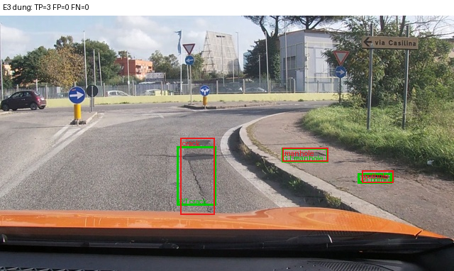
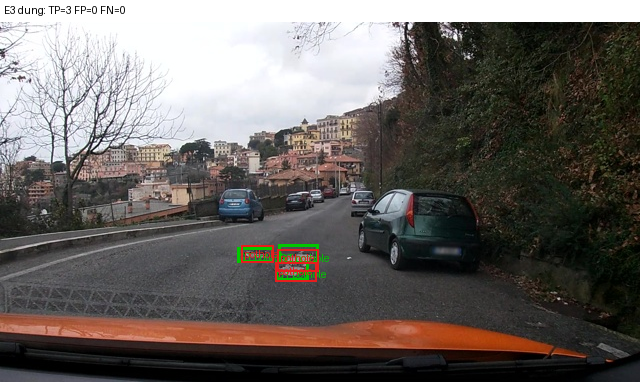
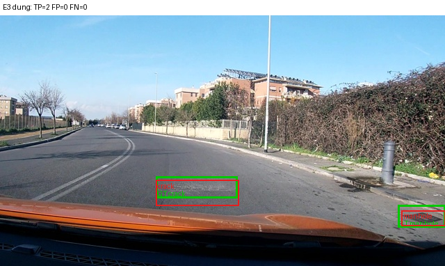
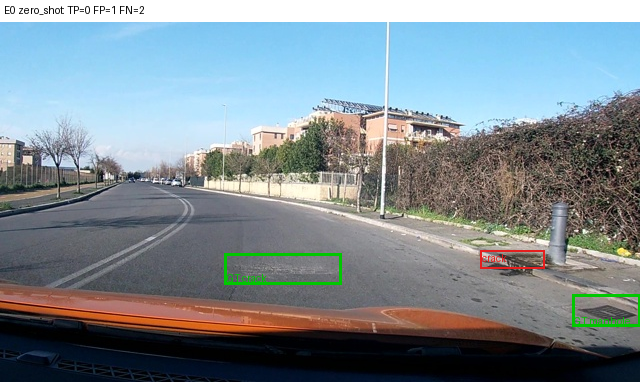
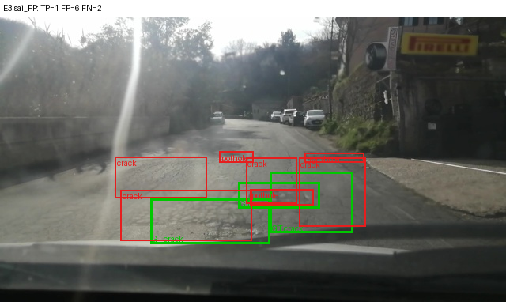
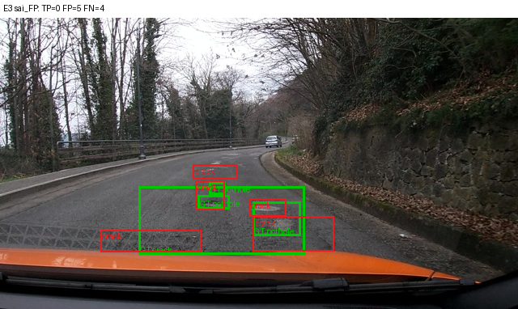
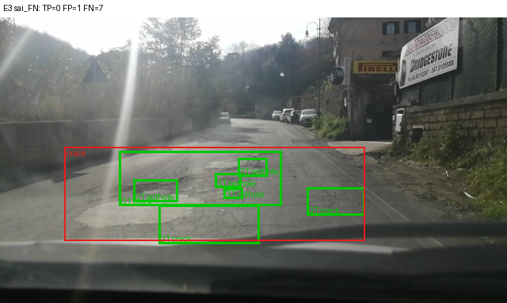
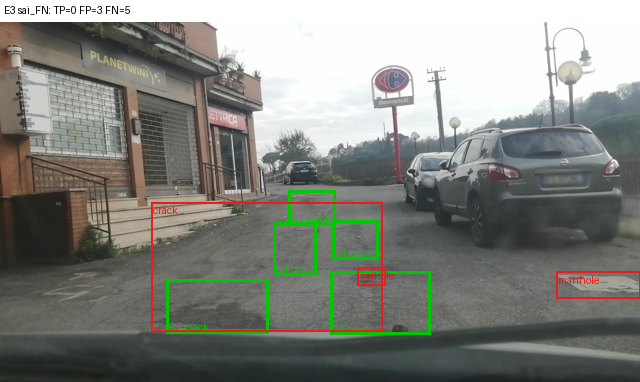
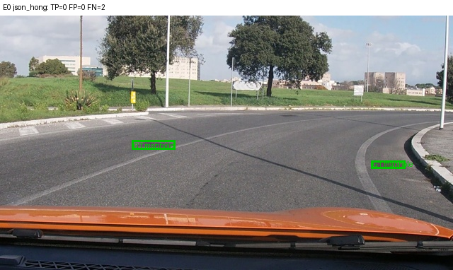

Họ tên: Phạm Văn Hoàng Anh Tú (2A202602507)
`dataset_version`: d10-21e4070301

> Môi trường: Kaggle, GPU Tesla T4 (chỉ dùng GPU 0), transformers 5.19.0, peft 0.21.2, trl 1.9.2, bitsandbytes 0.50.2.
> Toàn bộ số dưới đây lấy từ `report/evidence/*.json` (do `scripts/score.py` sinh), `report/runs/*/run.json`, `report/stats.json`.
> Mã: `lab10/` (chạy `python -m lab10.run all`), notebook `lab_day10.ipynb` / `kaggle_lab10.ipynb`.

## Bảng tổng hợp (số của bạn, lấy từ `report/evidence/*.json`)

| Mã | Setup | Tham số huấn luyện | VRAM đỉnh (GB) | Phút | F1 | CI95 | FP/ảnh | F1 pothole | F1 crack | F1 manhole |
|---|---|---|---|---|---|---|---|---|---|---|
| E0 | zero-shot | 0 | – (không train) | – | 0.0924 | [0.0658, 0.1226] | 0.981 | 0.1366 | 0.0301 | 0.2008 |
| E1 | LoRA LLM | 33,030,144 | 6.78 | 43.7 | 0.2803 | [0.2427, 0.3189] | 1.183 | 0.2172 | 0.1948 | 0.5279 |
| E2 | + projector | 142,135,296 | 8.50 | 44.2 | 0.3437 | [0.3043, 0.3861] | 1.039 | 0.1743 | 0.2717 | 0.6113 |
| E3 | + LoRA ViT | 148,426,752 | 8.69 | 52.3 | 0.4571 | [0.4142, 0.5024] | 0.817 | 0.3251 | 0.3713 | 0.7010 |
| E4 | `data_size` = 0.1 (setup E3) | 148,426,752 | 8.33 | 51.8 | 0.2751 | [0.2427, 0.3107] | 1.875 | 0.2053 | 0.1902 | 0.5666 |
| E4 | `data_size` = 1.0 (= lần chạy E3) | 148,426,752 | 8.69 | 52.3 | 0.4571 | [0.4142, 0.5024] | 0.817 | 0.3251 | 0.3713 | 0.7010 |
| E5 | GRPO từ E3 (bonus) | 39,321,600 | 7.82 | 27.4 | 0.4675 | [0.4264, 0.5117] | 0.814 | 0.3382 | 0.3881 | 0.6987 |

Chi tiết thêm (cùng nguồn): `parse_valid_rate` E0 = 0.932, E1 = 0.997, E2 = E3 = E5 = 1.000, E4(0.1) = 0.997; `missing_predictions` = 0 ở mọi file; mean IoU của box khớp: E0 0.604, E1 0.676, E2 0.675, E3 0.699, E5 0.696.
Ngưỡng tự động: E1 `parse_valid_rate` 0.997 ≥ 0.95; F1(E1) − F1(E0) = 0.2803 − 0.0924 = **0.188** ≥ 0.10.

**Nhật ký tài nguyên.** VRAM đỉnh = `torch.cuda.max_memory_allocated()` trong lúc train; "Phút" = thời gian thật của vòng train 300 bước (không tính nạp model và suy luận). Suy luận 311 ảnh test (batch 4, `max_new_tokens=256`) mất khoảng 12 phút ở E0 và 18 phút với model E3. Tổng cả lần chạy E0→E5 trên Kaggle ≈ 5 giờ 20 phút.

## Ảnh minh hoạ

Xanh lá = box đúng (GT), đỏ = box dự đoán. Ảnh và output thô ở `report/figures/` (`captions.json`).

| | |
|---|---|
|  E3 đúng cả 3 lớp: TP=3, FP=0, FN=0 |  E3 đúng 3 ổ gà sát nhau: TP=3 |
|  E3 đúng crack + manhole ở mép ảnh: TP=2 |  Cùng ảnh đó với E0: 1 box crack sai chỗ, bỏ sót cả 2 (TP=0, FP=1, FN=2) |
|  E3 sai: GT 3 crack, model vẽ 7 box (TP=1, FP=6, FN=2), cắt một vết nứt dài thành nhiều đoạn |  E3 sai lớp: 3 ổ gà bị gọi là crack (TP=0, FP=5, FN=4) |
|  E3 sai: mặt đường hư nặng có 7 GT, model gộp thành 1 box crack khổng lồ (FN=7) |  E3 sai: 5 crack mảnh, model gộp 1 box lớn + bịa pothole, manhole (FP=3, FN=5) |
|  E0: output lặp vô hạn bị cắt ở 256 token → JSON hỏng, không có box nào (FN=2) | |

## 10 câu hỏi (trả lời bằng **số của bạn**, không chép lại tài liệu)

### Câu 1 — Kiến trúc: ViT, projector và LLM của Qwen3-VL-4B có bao nhiêu tham số mỗi khối, và E1/E2/E3 mỗi cái cập nhật khối nào?

Đếm trên model đầy đủ dựng từ config thật (`report/stats.json`, `param_counts`):

| Khối | Tham số |
|---|---|
| ViT: patch embed + 24 block (`model.visual.blocks`) | 306,242,560 |
| Projector `visual.merger` | 27,271,680 |
| Projector `visual.deepstack_merger_list` (3 merger, lấy đặc trưng ở lớp 5, 11, 17) | 81,833,472 |
| → ViT + projector | 415,347,712 |
| LLM: 36 decoder layer + norm | 3,633,511,936 |
| `embed_tokens` (dùng chung trọng số với `lm_head`, nên `lm_head` không cộng thêm) | 388,956,160 |
| → LLM | 4,022,468,096 |
| **Tổng** | **4,437,815,808** |

Khối được cập nhật (số lấy từ `run.json`):
- **E1**: chỉ LoRA r=16 trên 252 module của LLM (q/k/v/o + gate/up/down × 36 lớp) = 33,030,144 tham số (0.74% model). ViT, projector, LLM gốc đóng băng.
- **E2**: E1 + mở **toàn bộ** projector (109,105,152 tham số, huấn luyện ở fp32) = 142,135,296. Phần tăng thêm đúng bằng số tham số projector.
- **E3**: E2 + LoRA trên 96 module của ViT (qkv, proj, linear_fc1, linear_fc2 × 24 block): 348 module LoRA, 39,321,600 tham số LoRA (thêm 6,291,456 so với E1) + projector = 148,426,752.

### Câu 2 — E0: `parse_valid_rate` bằng bao nhiêu, và hai lỗi phổ biến nhất của model gốc là gì (kèm một ví dụ output thô)?

`parse_valid_rate` E0 = **0.932**: 21/311 output không đọc được. Model gốc đã dùng đúng thang 0–1000 (không có toạ độ nào > 1000) và không bọc ```` ```json ````, nên F1 vẫn khác 0 (0.0924). Hai lỗi chính:

1. **Lặp vô hạn rồi bị cắt → JSON hỏng.** Cả 21 output hỏng đều là một chuỗi box crack trượt dần 50 đơn vị cho tới khi chạm `max_new_tokens=256`, nên thiếu dấu `]`. Ví dụ thô (ảnh `vlcsnap-2025-02-18-23h13m59s036`, GT là 2 manhole):
   `[{"label": "crack", "bbox_2d": [375, 500, 500, 550]}, {"label": "crack", "bbox_2d": [375, 550, 500, 600]}, {"label": "crack", "bbox_2d": [375, 600, 500, 650]}, ... {"label": "crack", "bbox_2d"` (bị cắt)
2. **Bịa box crack, nhất là một box khổng lồ phủ cả mặt đường.** 232/348 box của E0 là crack, trong đó 224 là FP (F1 crack chỉ 0.030). 32 box chiếm > 25% khung hình, ví dụ output thô thứ 2 của tập test: `[{"label": "crack", "bbox_2d": [0, 476, 1000, 999]}]`. Model gốc coi "cả nửa dưới mặt đường" là một vết nứt.

Ngoài ra E0 dự đoán quá ít box (1.20 box/ảnh, trong khi GT có 583/311 = 1.87 box/ảnh) nên recall chỉ 0.074.

### Câu 3 — Thang 0–1000: nếu chấm output theo pixel (hoặc ngược lại) thì F1 ra sao và vì sao? Bạn đã kiểm chứng điều này thế nào?

**Kiểm chứng:** mình chấm lại đúng file dự đoán của E1 và E3 bằng `scripts/score.py --coord pixel` (kết quả ở `report/extra/`):

| | `--coord norm1000` (đúng) | `--coord pixel` (sai) |
|---|---|---|
| E1 | F1 0.2803, TP 155 | **F1 0.0000**, TP 0, FP/ảnh 1.682 |
| E3 | F1 0.4571, TP 248 | **F1 0.0000**, TP 0, FP/ảnh 1.614 |

**Vì sao về 0:** khi coi số 0–1000 là pixel, `score.py` đổi sang thang 1000 bằng `x/640·1000` và `y/360·1000`, tức là kéo giãn x lên 1.5625 lần và y lên 2.78 lần, tính từ góc trên trái. Hư hại nằm ở nửa dưới ảnh (y ≈ 450–800 trên thang 1000). Sau khi nhân 2.78, y thành 1250–2200, nằm hẳn ngoài khung, nên mọi IoU = 0 < 0.5. Mọi box dự đoán thành FP và mọi GT thành FN. Parse vẫn hợp lệ (0.997), nên đây đúng là triệu chứng "F1 ≈ 0 mà JSON hợp lệ" trong bảng sự cố của GUIDE.

**Chiều ngược lại** (model in pixel nhưng chấm như 0–1000): x bị nén còn 0.64 lần, y còn 0.36 lần, nên box bị dồn về phía trên bên trái. Ví dụ một ổ gà ở y = 250 px (≈ 694 trên thang 1000) bị đọc là y = 250 trên thang 1000, lệch gần 450 đơn vị, F1 cũng gần 0. Qwen3-VL dùng thang 0–1000 vì nó không phụ thuộc kích thước ảnh: ảnh 640×360 bị resize về 640×352 trong processor, toạ độ pixel tuyệt đối sẽ không còn khớp, còn toạ độ tương đối thì vẫn đúng.

### Câu 4 — Mask loss: vì sao chỉ tính loss trên phần trả lời? Điều gì xảy ra nếu tính trên cả prompt và token ảnh?

Với ví dụ đầu tiên của train (`20250216_164325`, 9 box), chuỗi đầy đủ có **586 token**: **220 token ảnh** `<|image_pad|>` (ảnh 640×360 → lưới 40×22 patch 16 px → gộp 2×2 → 20×11 = 220), cộng system/prompt, tổng cộng **336 token bị mask** (`-100`), và **250 token được tính loss**. Giải mã riêng các token có `labels != -100` ra đúng JSON đáp án + `<|im_end|>` (đã kiểm tra trong `stats.json`).

Lý do chỉ học phần trả lời:
- Ta muốn model học **p(đáp án | ảnh, prompt)**, không phải học sinh lại prompt. Prompt giống hệt nhau ở 1422 ảnh, nên nếu tính loss trên nó, model chỉ học thuộc một đoạn văn cố định. Đoạn này rất nhanh về loss ≈ 0, làm loss trung bình trông thấp mà tín hiệu học grounding không tăng.
- 220 token ảnh là placeholder `<|image_pad|>`, embedding thật của chúng được thay bằng đặc trưng ViT. "Dự đoán token ảnh kế tiếp" là dự đoán một token hằng, không có ý nghĩa, nhưng chiếm 220/586 = 38% chuỗi.
- Nếu tính loss trên cả 586 token thì 57% gradient (336/586) đi vào phần vô ích. Phần JSON, nơi chứa toạ độ, chỉ còn 43% trọng số loss. Model học grounding chậm hơn, và có thể học thói quen sinh lại prompt hoặc token ảnh trong câu trả lời (làm hỏng parse).

Bằng chứng thực nghiệm cho thấy mask đúng chỗ: loss ở bước 1 là 1.77 (chỉ tính trên JSON), giảm còn 0.48–0.63 sau 300 bước, và `parse_valid_rate` của E1 lên 0.997. Mình không chạy riêng một thí nghiệm "không mask", nên đoạn phân tích hệ quả ở trên là lập luận dựa trên tỉ lệ token, chưa có số đo.

### Câu 5 — Vì sao không thể huấn luyện đầy đủ projector nếu ViT bị lượng tử hoá 4-bit, và bạn đã xử lý thế nào? Vì sao projector phải ở float32?

Khi lượng tử hoá 4-bit, `nn.Linear` bị thay bằng `bnb.Linear4bit`. Trọng số lúc này là `Params4bit` kiểu uint8, gói 2 giá trị NF4 vào 1 byte, kèm hằng số scale. Đây không phải tensor số thực, nên không có gradient cho từng phần tử và optimizer không cập nhật được. Chỉ có thể gắn LoRA lên trên (QLoRA), không thể "huấn luyện đầy đủ". Projector (`visual.merger`, `visual.deepstack_merger_list`) nằm trong `model.visual`, nên nếu ViT bị lượng tử hoá thì projector cũng bị.

**Mình đã gặp đúng lỗi này.** Cấu hình trong GUIDE, `llm_int8_skip_modules=["visual", "lm_head"]`, **không có tác dụng** với transformers 5.19. Bản này so khớp skip module bằng `re.match` từ **đầu** tên đầy đủ (`model.visual.blocks.0.attn.qkv`) hoặc `endswith`, nên `"visual"` không khớp và ViT vẫn bị nén 4-bit. Triệu chứng trong lần chạy thử:
- số tham số projector "huấn luyện được" chỉ là 54,579,200, tức đúng một nửa 109,105,152, vì uint8 gói 2 giá trị vào 1 phần tử;
- E2/E3 dừng ở bước đầu với lỗi `ValueError: Attempting to unscale FP16 gradients`.

**Cách xử lý:** thêm `"model.visual"` vào `llm_int8_skip_modules`, và thêm một bước kiểm tra sau khi nạp model (`lab10/modeling.py: check_vit_not_quantized`): báo lỗi nếu còn `Linear4bit` nào trong `visual`, hoặc nếu LLM không bị nén. Sau khi sửa, projector có đủ 109,105,152 tham số huấn luyện, khớp con số ≈ 109M của GUIDE.

**Vì sao projector phải ở float32:** model chạy fp16, còn T4 không có bf16, nên dùng `GradScaler`. GradScaler bắt buộc mọi tham số có gradient phải là fp32. Nó từ chối unscale gradient fp16 (chính lỗi ở trên), vì fp16 chỉ có ~3 chữ số thập phân. Với lr = 2e-4, bước cập nhật `lr·g` thường nhỏ hơn khoảng cách giữa hai số fp16 liền kề quanh giá trị trọng số, nên phép cộng bị làm tròn mất và trọng số không đổi. Giữ "master weight" fp32 cho projector (109M tham số × 4 byte ≈ 0.44 GB, cộng 2 trạng thái Adam ≈ 0.87 GB) cho phép cập nhật nhỏ được tích luỹ. Lúc forward, autocast vẫn tính các phép nhân ma trận ở fp16. Adapter LoRA cũng ở fp32 vì peft tự nâng kiểu (`autocast_adapter_dtype`). Điều này giải thích VRAM của E2 (8.50 GB) cao hơn E1 (6.78 GB) khoảng 1.7 GB.

### Câu 6 — Split theo phiên quay: vì sao chia ngẫu nhiên sẽ cho F1 cao giả? Số ảnh và số box từng lớp ở mỗi split là bao nhiêu?

Ảnh là các frame cắt từ video dashcam. Hai frame liền nhau trong cùng một phiên gần như trùng nhau: cùng đoạn đường, cùng ổ gà, chỉ lệch vài pixel. Nếu chia ngẫu nhiên theo ảnh, gần như mọi ảnh test sẽ có "anh em sinh đôi" trong train. Model chỉ cần nhớ (đoạn đường X có ổ gà ở toạ độ Y) là được điểm cao. F1 khi đó đo khả năng **nhớ**, không đo khả năng **tổng quát hoá** sang đoạn đường mới, nên đó là F1 cao giả.

E4 của mình cho thấy model nhớ nhanh thế nào: với 142 ảnh, loss train tụt từ 2.19 xuống **0.0066** (gần như thuộc lòng), nhưng F1 test chỉ 0.275. Nếu test chứa frame gần trùng với train thì con số này sẽ cao hơn nhiều, và ta sẽ kết luận sai rằng model tốt.

`prepare_data.py` gom ảnh theo phiên (ngày + giờ trong tên file) và gán **cả phiên** vào một split. Mình kiểm tra lại: không có phiên nào nằm ở hai split (`session_overlap` = 0/0/0).

| Split | Phiên | Ảnh | pothole | crack | manhole | Diện tích box trung vị (pothole / crack / manhole) |
|---|---|---|---|---|---|---|
| train | 13 | 1,422 | 1,074 | 1,750 | 691 | 0.38% / 1.35% / 0.39% khung hình |
| val | 2 | 276 | 66 | 470 | 103 | 0.38% / 1.32% / 0.66% |
| test | 3 | 311 | 121 | 299 | 163 | 0.42% / 1.98% / 0.67% |

Mặt trái là phân bố lớp lệch giữa các split (val chỉ có 66 pothole) và test chỉ có 3 phiên. Hệ quả của điều này được bàn ở Câu 8.

### Câu 7 — So sánh E1/E2/E3: mở projector và LoRA trên ViT có đáng không (F1, CI95, VRAM, thời gian)?

| | F1 | CI95 | Δ F1 | VRAM | Phút train |
|---|---|---|---|---|---|
| E1 | 0.2803 | [0.243, 0.319] | | 6.78 GB | 43.7 |
| E2 | 0.3437 | [0.304, 0.386] | +0.063 so với E1 | 8.50 GB (+1.72) | 44.2 (+0.5) |
| E3 | 0.4571 | [0.414, 0.502] | +0.113 so với E2, +0.177 so với E1 | 8.69 GB (+0.19) | 52.3 (+8.6) |

- **Mở projector (E2)**: F1 tăng 0.063 và FP/ảnh giảm 1.18 → 1.04. Tuy nhiên CI của E1 và E2 **chồng nhau** (0.304–0.319), nên với tập test này mình không khẳng định chắc chắn được. Chi phí gần như chỉ là VRAM (+1.7 GB cho tham số fp32 và trạng thái Adam), thời gian không đổi.
- **LoRA trên ViT (E3)**: tăng thêm 0.113 F1 và CI **không chồng** với E2 (0.386 < 0.414), nên đây là cải thiện đứng vững. Lớp nào cũng tăng: pothole 0.17 → 0.33, crack 0.27 → 0.37, manhole 0.61 → 0.70. FP/ảnh giảm còn 0.82. Chi phí gồm +0.19 GB VRAM (đồ thị gradient đi qua 24 block ViT, có gradient checkpointing) và +8.6 phút (+20%) vì backward phải chạy qua ViT.
- **Kết luận:** E3 đáng đồng tiền nhất. Với 9 phút và 1.9 GB thêm so với E1, F1 tăng 63% tương đối, vẫn vừa trong 16 GB của T4. Hợp lý về bản chất: ViT gốc được huấn luyện cho ảnh tự nhiên chung chung, còn ổ gà 30 px trên mặt đường cần đặc trưng thị giác chuyên biệt. Chỉ chỉnh LLM (E1) thì không tạo ra được đặc trưng đó.

### Câu 8 — Tập test có 311 ảnh: khoảng tin cậy rộng thế nào, và điều đó giới hạn kết luận so sánh các setup ra sao?

CI95 bootstrap theo ảnh (1000 lần lấy mẫu lại) rộng **0.057–0.088**, tức khoảng ±0.03 đến ±0.044 quanh F1:
E0 0.057 · E1 0.076 · E2 0.082 · E3 0.088 · E4(0.1) 0.068 · E5 0.085.

Hệ quả:
- Chênh lệch dưới ~0.08 giữa hai setup thì CI thường chồng nhau, không đủ để kết luận. Ví dụ: E1 → E2 (+0.063, chồng), E3 → E5 (+0.010, chồng gần hoàn toàn), E1 so với E4-10% (0.280 vs 0.275, gần như trùng).
- Chỉ các khoảng cách lớn mới đứng vững: E0 → E1 (+0.188), E2 → E3 (+0.113), E4 10% → 100% (+0.182). Ở các cặp này CI tách hẳn nhau.
- So sánh hai CI độc lập là cách bảo thủ. Các setup chấm trên **cùng** 311 ảnh, nên một bootstrap ghép cặp (lấy mẫu lại cùng ảnh cho cả hai setup) sẽ cho CI của *hiệu số* hẹp hơn. Mình chưa làm phép thử đó, nên với E1 so với E2 mình chỉ nói "có xu hướng tốt hơn".
- **Bootstrap theo ảnh vẫn đánh giá thấp độ bất định thật.** 311 ảnh test chỉ đến từ **3 phiên quay**, các frame trong một phiên tương quan mạnh với nhau. Số "mẫu độc lập" thực sự ít hơn 311 nhiều, nên CI thật còn rộng hơn. Ngoài ra mỗi setup chỉ chạy 1 seed (42). Vì vậy kết luận cuối cùng chỉ nên là: thứ tự E0 < {E1, E2, E4-10%} < {E3, E5} là đáng tin, còn thứ tự bên trong mỗi nhóm thì chưa.

### Câu 9 — Phân tích lỗi theo lớp: lớp nào kém nhất và vì sao (kích thước box, số mẫu, ngữ nghĩa)? Kèm ảnh minh hoạ.

F1 theo lớp của E3 (TP / FP / FN): **pothole 0.325** (33 / 49 / 88) · crack 0.371 (106 / 166 / 193) · **manhole 0.701** (109 / 39 / 54).

**Pothole kém nhất**, chủ yếu do bỏ sót (recall 33/121 = 27%):
- **Kích thước:** diện tích trung vị chỉ 0.42% khung hình ở test, tương đương ô vuông ~31×31 px. Mỗi token thị giác của Qwen3-VL ứng với 32×32 px (patch 16 px, gộp 2×2), nên **một ổ gà gần như chỉ nằm trong 1 token**. Sai một token là IoU tụt dưới 0.5. Manhole cũng nhỏ (0.67%, ~39 px) nhưng có hình tròn/vuông, viền kim loại, rất đặc trưng.
- **Ngữ nghĩa:** ổ gà và vết nứt lẫn vào nhau, vì mặt đường hư thường có cả hai. Ảnh `e3_sai_FP_…17h03m29s526` cho thấy 3 ổ gà bị gọi là crack (TP = 0). Ảnh `e3_sai_FN_…23h30m28s990` có 4 pothole + 3 crack trên một đoạn đường nát, model gộp tất cả thành **một** box crack lớn (FN = 7).
- **Số mẫu:** pothole có 1,074 box train, ít hơn crack (1,750), nhưng nhiều hơn manhole (691). Vì manhole ít mẫu nhất mà vẫn tốt nhất, số mẫu không phải nguyên nhân chính. Kích thước và độ mơ hồ ngữ nghĩa mới là nguyên nhân chính.

**Crack** có nhiều FP nhất (166). Vết nứt dài, mảnh, ranh giới mơ hồ: một vết nứt có thể được gán nhãn thành 1 box dài hoặc vài box ngắn. Ảnh `e3_sai_FP_…23h30m29s649` có 3 GT nhưng model chia thành 7 box (FP = 6), ảnh `e3_sai_FN_…23h24m36s429` thì ngược lại, model gộp 5 vết nứt mảnh thành 1 box. Với ngưỡng IoU 0.5, cả hai cách chia sai đều bị phạt nặng.

Thêm nữa, mọi model đều **dự đoán thiếu box**: E3 1.61 box/ảnh, trong khi GT có 1.87. Đây là lý do recall (0.425) thấp hơn precision (0.494).

### Câu 10 — E4: bạn đổi biến nào, kết quả thế nào, và kết luận có đáng tin không?

**Biến:** `data_size` (tỉ lệ ảnh train), trên setup tốt nhất E3, mọi thứ khác giữ nguyên (r = 16, lr = 2e-4, 300 bước, batch 2 × 4, seed 42).
- **0.1:** 142 ảnh lấy ngẫu nhiên (seed 42) từ 1,422 ảnh train → `e4_data_size_0.1.json`.
- **1.0:** chính lần chạy E3 (cùng cấu hình), chấm lại cùng file dự đoán dưới tên `E4_data_size_1.0` → `e4_data_size_1.0.json` (`meta.same_run_as = "E3"`).

| | F1 | CI95 | P / R | FP/ảnh | box/ảnh | loss cuối |
|---|---|---|---|---|---|---|
| 10% (142 ảnh) | 0.2751 | [0.243, 0.311] | 0.242 / 0.319 | 1.875 | 2.48 | 0.0066 |
| 100% (1,422 ảnh) | 0.4571 | [0.414, 0.502] | 0.494 / 0.425 | 0.817 | 1.61 | 0.479 |

**Kết quả:** giảm còn 10% dữ liệu làm F1 giảm 0.182 (−40%), mạnh nhất ở precision (0.494 → 0.242). Model 10% sinh nhiều box hơn hẳn (2.48 box/ảnh, FP/ảnh 1.875 gấp 2.3 lần). Đây là dấu hiệu **overfit**: 300 bước × 8 ảnh = 2,400 lượt xem trên 142 ảnh ≈ **17 epoch**, loss train tụt về 0.0066 (thuộc lòng đáp án), nhưng ra ảnh mới thì vẽ box tràn lan.

**Có đáng tin không:**
- Chiều kết luận "nhiều dữ liệu hơn thì tốt hơn rõ rệt" là **đáng tin**: hai CI cách nhau xa (0.311 < 0.414), khoảng cách 0.10 lớn hơn độ rộng mỗi CI.
- Độ lớn chính xác của hiệu ứng thì kém chắc chắn hơn: 1 seed, 1 cách lấy mẫu 10%, và test chỉ có 3 phiên (Câu 8).
- Biến này **không hoàn toàn "sạch"**: vì giữ số bước cố định 300 theo đề, 10% dữ liệu đồng nghĩa với số epoch gấp 10 lần. Kết quả trả lời câu hỏi "cùng ngân sách tính toán, ít dữ liệu hơn thì sao", không phải "cùng số epoch". Muốn tách hai yếu tố thì cần thêm một lần chạy 10% với 30 bước.

## E5 (bonus): GRPO với reward IoU

**Hàm reward** (`lab10/reward.py`): bằng 0 nếu JSON hỏng, bằng 1 nếu GT và dự đoán đều rỗng. Còn lại là `0.2 + 0.8 · ΣIoU / max(n_gt, n_pred, 1)`, với ghép đôi tham lam theo IoU giảm dần, cùng lớp, IoU ≥ 0.5. Có **13 unit test** (`lab10/tests/test_reward.py`, chạy `python -m pytest lab10/tests`), bao gồm: hoàn hảo = 1, thứ tự không quan trọng, JSON hỏng = 0, có bọc ```` ```json ```` vẫn đọc được, sai lớp = 0.2, IoU < 0.5 không được tính, box thừa bị phạt qua mẫu số, trả `[]` khi có GT = 0.2, ảnh rỗng mà trả `[]` = 1, ảnh rỗng mà vẽ box = 0.2, **một box khổng lồ phủ cả ảnh = 0.2** (không lách được), IoU từng phần được tính tỉ lệ, mỗi GT chỉ khớp một lần.

**Chạy GRPO** (`lab10/grpo.py`, `trl.GRPOTrainer`, log đầy đủ ở `report/runs/e5/loss_log.json`): khởi tạo từ adapter E3 (gồm projector, giữ đóng băng), chỉ train 39,321,600 tham số LoRA; 60 bước, `num_generations=4`, `max_completion_length=128`, lr 5e-6, β = 0, `use_vllm=False`; 27.4 phút, VRAM đỉnh 7.82 GB.
Một lỗi phải sửa: với model 4-bit, TRL tự ép tham số LoRA sang bf16, mà T4 cộng GradScaler fp16 không unscale được bf16 (`_amp_foreach_non_finite_check_and_unscale_cuda not implemented for 'BFloat16'`). Mình đưa chúng về fp32 sau khi tạo trainer.

Reward trung bình theo từng 10 bước: 0.479 → 0.408 → 0.388 → 0.432 → 0.408 → 0.361. Reward **dao động, không có xu hướng tăng**: mỗi bước chỉ có 1 ảnh × 4 mẫu nên rất nhiễu, và tối đa 20% số bước có 4 mẫu cùng reward (`frac_reward_zero_std`), tức không có tín hiệu học.

**Reward hacking?** Không thấy dấu hiệu. So với SFT (E3) trên 311 ảnh test:

| | E3 (SFT) | E5 (GRPO) |
|---|---|---|
| Output `[]` | 0 | 0 |
| Box chiếm > 25% khung hình | 0 | 0 |
| Box/ảnh | 1.61 | 1.63 |
| Diện tích box trung vị | 1.03% | 1.01% |
| Độ dài output trung bình | 76 ký tự | 77 ký tự |

Hàm reward đã chặn sẵn hai kiểu lách luật phổ biến: trả `[]` chỉ được 0.2 khi ảnh có GT, và một box khổng lồ có IoU < 0.5 với các box nhỏ nên cũng chỉ được 0.2.

**So với SFT:** F1 0.4675 [0.426, 0.512] so với 0.4571 [0.414, 0.502], tức +0.010. Pothole +0.013, crack +0.017, manhole −0.002. Mức tăng này **nằm hoàn toàn trong CI95**, nên không thể kết luận GRPO cải thiện. Điều này dễ hiểu: 60 bước × lr 5e-6 là một cập nhật rất nhỏ so với 300 bước × lr 2e-4 của SFT.

## Nhìn lại

- **Công cụ chấm không bắt được lỗi lượng tử hoá ViT.** Nếu chỉ đọc số, E2/E3 với ViT bị nén 4-bit vẫn có thể "chạy" (khi không dùng GradScaler) và cho kết quả trông giống E1. Mình chỉ phát hiện được nhờ số tham số projector lệch đúng một nửa (54.6M so với 109.1M). Từ đó mình học được: sau khi nạp model phải kiểm tra kiểu từng module, không tin vào cấu hình.
- **Môi trường quan trọng ngang code.** Ba lỗi mình gặp đều không nằm ở thuật toán: cách so khớp `llm_int8_skip_modules` của transformers 5.x, bản torchao 0.10 có sẵn trên Kaggle làm peft báo lỗi khi gắn LoRA lên ViT, và TRL tự ép bf16. Cả ba chỉ lộ ra trên GPU thật. Lần chạy thử 5 bước ("smoke test") trước khi chạy 5 tiếng đã tiết kiệm rất nhiều thời gian.
- **Điều chưa hiểu hết:** vì sao E2 làm F1 pothole giảm (0.217 → 0.174) trong khi crack và manhole tăng. Có thể do nhiễu (pothole chỉ có 121 box test), hoặc do projector fp32 với lr 2e-4 thay đổi đặc trưng theo hướng có lợi cho các box lớn hơn. Cần nhiều seed hơn mới biết được.
- **Dữ liệu:** nhãn crack rất không nhất quán (một vết nứt dài có khi 1 box, có khi nhiều box), và một số ảnh đường nát có box lồng nhau giữa pothole và crack. Metric IoU ≥ 0.5 phạt nặng cả hai kiểu. Công cụ chấm không phân biệt "sai do nhãn mơ hồ" với "sai thật".
- **Lưu ý về test của đề:** sau khi điền báo cáo này, `tests/test_configs_and_docs.py::test_report_template_has_student_markers_and_ten_questions` sẽ fail vì nó kiểm tra mẫu báo cáo còn chuỗi giữ chỗ. Đó là hành vi mong đợi, mình không sửa `tests/`. `scripts/check_submission.py` là thứ được chấm.
